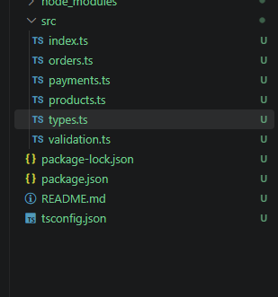
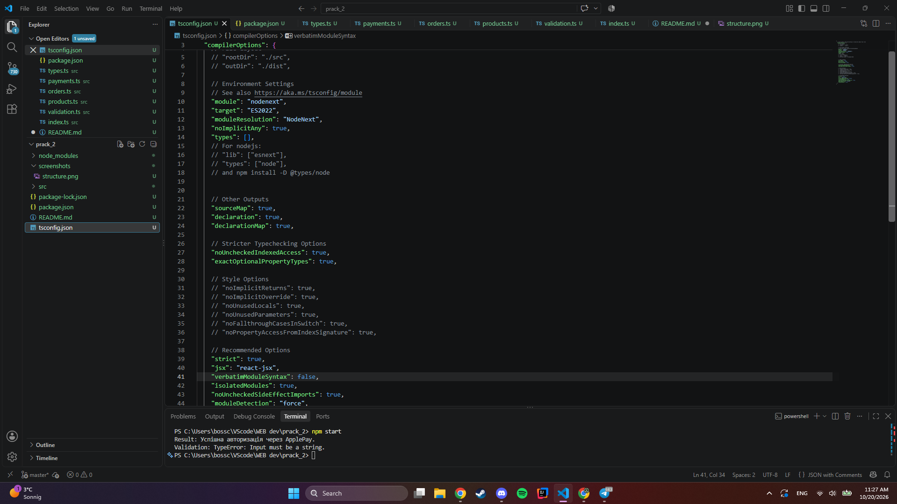
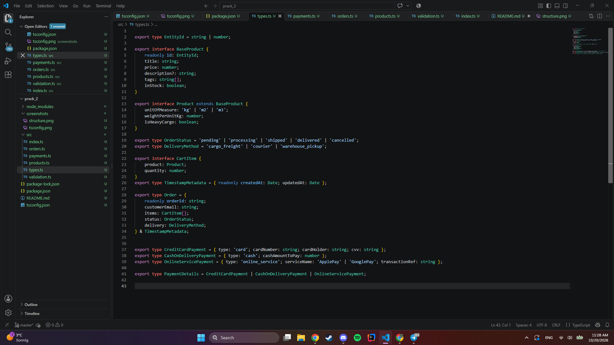
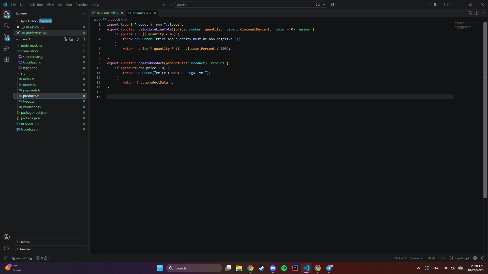
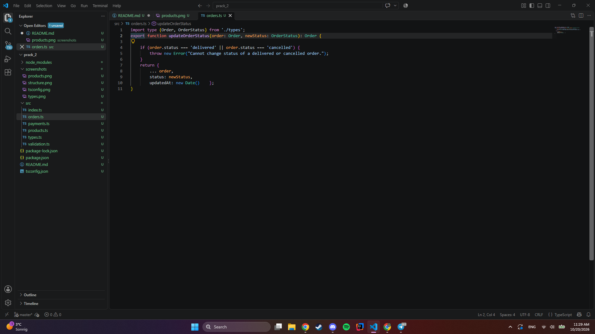
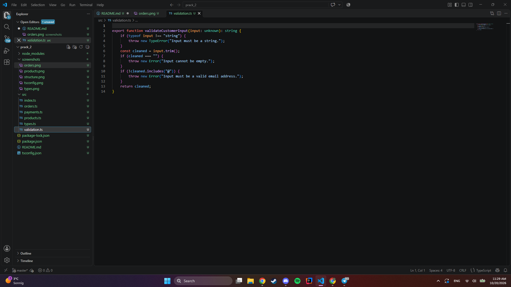
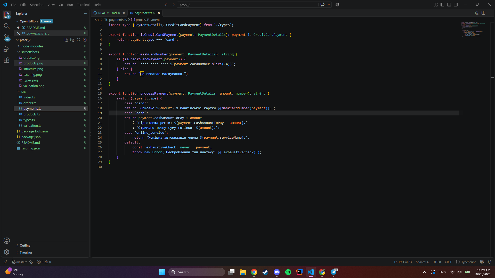
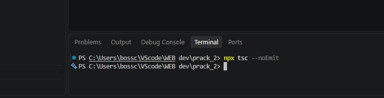
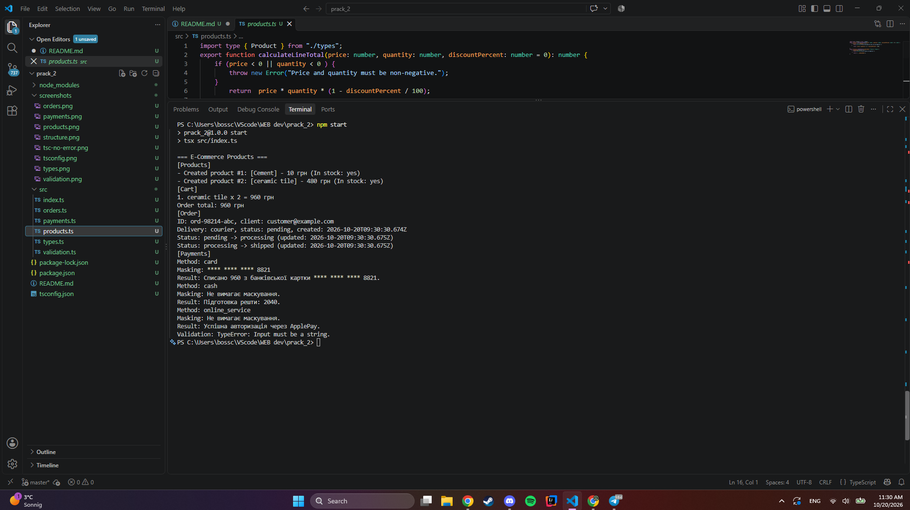

# Практична робота №2. Базові засоби системи типів TypeScript

**Виконав: ПІБ, група
**Варіант:** 6 (Будівельні матеріали)

## Опис

Типізоване ядро інтернет-магазину (E-Commerce Core Engine) на чистому TypeScript, без `any`. Модель охоплює каталог товарів, кошик, замовлення та способи оплати.

## Структура проєкту

## Запуск
npm install
npm start

Перевірка типів: `npx tsc --noEmit`

## Налаштування (tsconfig.json)

Увімкнено `strict`, `noImplicitAny`, `target: ES2022`, `module` і `moduleResolution`: `NodeNext`.

## Рівень 1. Сутності каталогу

- `EntityId = string | number`
- `BaseProduct` має поля `id` (readonly), `title`, `price`, `description?`, `tags`, `inStock`.
- `Product` розширює `BaseProduct` полями варіанта 6: `unitOfMeasure` (`'kg' | 'm2' | 'm3'`), `weightPerUnitKg`, `isHeavyCargo`.
- `createProduct` повертає копію товару й кидає `Error` при від'ємній ціні.
- `calculateLineTotal(price, quantity, discountPercent = 0)` рахує суму позиції й кидає `Error` при від'ємних ціні чи кількості.

## Рівень 2. Замовлення і безпечні дані

- `OrderStatus` і `DeliveryMethod` (`'cargo_freight' | 'courier' | 'warehouse_pickup'`) є union-типами рядкових літералів.
- `Order` складається через перетин (`&`) з `TimestampMetadata`.
- `updateOrderStatus` є чистою функцією: повертає новий об'єкт, не змінює вхідний. Зі статусів `delivered` та `cancelled` перехід заборонений (кидає помилку).
- `validateCustomerInput(input: unknown)` через `typeof` звужує тип до `string`. Не рядок дає `TypeError`, порожній рядок або відсутність `@` дає `Error`.

## Рівень 3. Discriminated Unions, Type Guards, never

- `CreditCardPayment`, `CashOnDeliveryPayment`, `OnlineServicePayment` мають спільний дискримінатор `type`, об'єднані в `PaymentDetails`.
- `isCreditCardPayment` є захисником типу (`payment is CreditCardPayment`).
- `maskCardNumber` показує лише останні 4 цифри картки, для інших способів повертає повідомлення, що маскування не потрібне.
- `processPayment` використовує `switch (payment.type)`. У гілці `default` змінна типу `never` гарантує, що додавання нового способу оплати без обробки викличе помилку компіляції.

## Результат роботи

Перевірка типів без помилок:

Вивід програми (`npm start`):

## Відповіді на контрольні питання

1. ...
2. ...
3. ...
4. ...
5. ...
6. ...
7. ...
8. ...